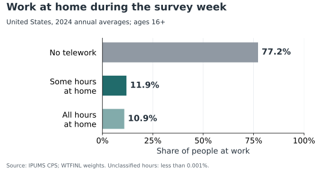
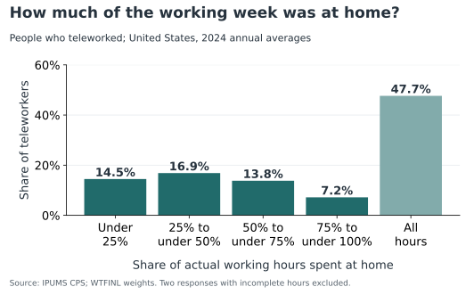
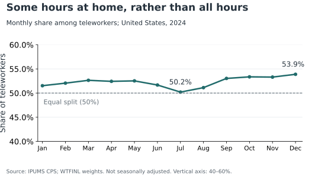

# Does working from home mean staying home all week?

Someone who works from home for a few hours on Friday and someone who stays home all week can both be counted as teleworkers. That makes “working from home” a surprisingly broad label. Before drawing conclusions about how much work has moved home, it helps to ask how much of the working week people actually spend there.

**Among U.S. workers who worked from home in 2024, was it more common to do all their work at home or only some of it?**

I used all twelve 2024 Basic Monthly samples from [IPUMS CPS](https://cps.ipums.org/), covering civilians ages 16 and older who worked during the survey reference week. The survey asks whether they worked from home for pay, how many hours they did so, and their total hours worked. I applied the person-level WTFINL weights so that the results describe the population rather than just the respondents.

## A little over half combined home and other working hours

{#fig-status fig-alt="Horizontal bars show 77.2 percent did no telework, 11.9 percent worked some hours at home, and 10.9 percent worked all hours at home in 2024."}

Across 2024, about 22.8% of people at work did at least some paid work from home. @fig-status separates that group into people who worked only some hours at home and those who worked every hour there. Both groups were much smaller than the group doing no telework.

Among teleworkers whose hours could be classified, 52.3% worked only some hours at home, while 47.7% worked all their hours there. The split was close. A slight majority had a mixed week, but working entirely from home was also common. Calling every teleworker fully remote would overlook more than half of this group.

## A remote week could contain very different amounts of home working

{#fig-intensity fig-alt="Five bars show the share of teleworkers by the fraction of working hours spent at home: 14.5 percent below one quarter, 16.9 percent from one quarter to under one half, 13.8 percent from one half to under three quarters, 7.2 percent from three quarters to under all hours, and 47.7 percent all hours."}

For each teleworker, I divided hours worked at home by total hours worked that week. Someone who worked 40 hours in total and 16 hours at home, for example, would have a home-working share of 40%.

@fig-intensity shows why the yes-or-no telework question leaves considerable variation hidden. About 31.3% of teleworkers spent less than half their working time at home. Others spent most of their week there, and the largest single category worked entirely from home. Sharing the same teleworker label therefore tells us relatively little about two people's weekly routines.

These are shares of hours, so they cannot tell us how many whole days someone stayed home. A few hours at home each evening could add up to the same total as two complete days.

## The close split appeared throughout the year

{#fig-monthly fig-alt="The share of teleworkers doing some rather than all hours at home remains above 50 percent in every month of 2024, ranging from 50.2 percent in July to 53.9 percent in December. The vertical axis runs from 40 to 60 percent."}

The annual result could conceal differences across months. @fig-monthly checks this by calculating the split separately for each survey month. The partial-home group had the larger point estimate in all twelve months. July was almost evenly divided at 50.2%; December's estimate was 53.9%.

These monthly estimates are not seasonally adjusted, and I have not tested whether the small differences are statistically significant. The useful finding is how close the two groups remained, rather than a claim that preferences changed during the year.

The main takeaway is that paid work at home often occupied only part of a person's working week. Debates about workplace attendance should make that distinction explicit. The CPS records what happened during one reference week; it does not identify a permanent hybrid contract, the location of the remaining hours, or whether someone preferred that arrangement.

## Data and replication

Source: IPUMS CPS, University of Minnesota; underlying data from the U.S. Census Bureau and Bureau of Labor Statistics. [Definitions](https://www.bls.gov/cps/telework.htm) · [Aggregate results](results/annual_summary.csv) · [Replication instructions](README.md).
