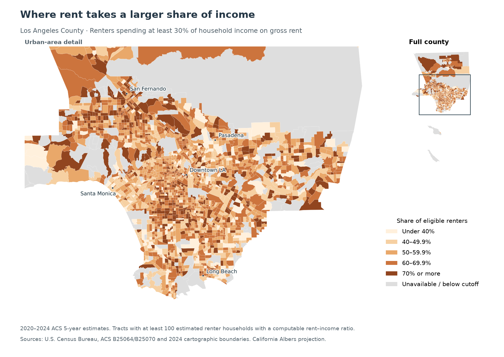

In Los Angeles County tracts with median monthly gross rents of $2,500 or more, 54.0% of renter households spent at least 30% of their income on rent. In tracts with median rents between $1,500 and $1,999, the share was 60.0%.

Are the places with the highest rents also the places where tenants struggle most to pay them? I compared monthly rent with rent as a share of income. The distinction matters for housing assistance: monthly rents alone leave out how much tenants earn.

I used the Census Bureau's 2020–2024 American Community Survey estimates for Los Angeles County. Census tracts are small statistical areas, rather than official neighborhood boundaries. These are rents paid by existing occupants, including covered utilities, not today's advertised apartment prices. The comparisons exclude households for which the Census cannot calculate a rent-to-income ratio.

## The expensive areas are easier to spot

{.column-page fig-alt="A projected map of Los Angeles County census tracts shows higher median gross rents concentrated toward western and coastal areas and some foothill communities. Many central and southern urban tracts have lower rents. The full-county inset includes northern areas and offshore islands."}

The county's median monthly gross rent was $1,954. The map shows higher rents toward the coast and western parts of the urban area, with expensive tracts in some foothill communities too. Many central and southern tracts fall into lower rent categories.

This map shows what tenants pay each month. To see how much of their income goes toward that bill, we need a second measure.

## The burden has a different geography

{.column-page fig-alt="The same Los Angeles County tract map shows rent burdens of at least 30 percent of income. Higher burdens appear across south and central urban areas, parts of the San Fernando Valley, and northern county tracts, rather than mirroring only the most expensive coastal areas."}

Countywide, 57.7% of eligible renter households spent at least 30% of income on gross rent, and 30.9% spent at least half.

Heavy burdens appear in many central and southern areas where rents are relatively modest, and in parts of the San Fernando Valley and northern county. Some expensive tracts have high burdens too. The pressure extends well beyond the high-rent areas along the coast.

Income helps explain why the two measures can differ. A hypothetical household earning $3,000 a month and paying $1,500 in gross rent spends half its income on housing. Another earning $10,000 and paying $2,500 spends a quarter. The more expensive home need not take the larger share of the household budget.

## Even the cheaper areas face substantial pressure

{.column-page fig-alt="Grouped horizontal bars show shares spending at least 30 percent and at least 50 percent of income on rent. Across rising tract rent bands, the 30-percent shares are 59.1, 60.0, 55.5, and 54.0 percent; the corresponding 50-percent shares are 32.3, 32.4, 29.5, and 28.0 percent."}

I grouped tracts into four rent bands, then calculated the burdened share of households in each group. Each household counts equally, so a tract with more renters gets more weight than one with fewer.

The share spending at least 30% of income on rent exceeded half in every band. It was 59.1% in tracts with median rents below $1,500, compared with 54.0% in the $2,500-or-more group. The shares spending at least half their income were 32.3% and 28.0%, respectively.

These estimates describe areas and their current renters. They do not show what would happen to the same household if it moved, or establish that a particular tract is more affordable for a new arrival. Sampling error also makes close comparisons uncertain.

Housing assistance needs to reach renters in relatively low-rent areas too. Even in tracts with median rents below $1,500, nearly one in three eligible renter households spent at least half their income on rent. A map of monthly prices alone would miss much of that strain.

## Data and code

[GitHub project and replication instructions](https://github.com/Devinshen123/devinshen123-website/tree/main/blog/posts/post5) · [Tract calculations (CSV)](results/tract_results.csv) · [Rent-band results (CSV)](results/rent_bands.csv)

The analysis uses ACS tables [B25064](https://api.census.gov/data/2024/acs/acs5/groups/B25064.html) and [B25070](https://api.census.gov/data/2024/acs/acs5/groups/B25070.html), downloaded programmatically from the official [2024 table-based Summary Files](https://www.census.gov/programs-surveys/acs/data/summary-file.2024.html), and [2024 Census cartographic tract boundaries](https://www.census.gov/geographies/mapping-files/time-series/geo/cartographic-boundary.html). Retrieval date: October 19, 2026, Pacific time. Dollars in these five-year estimates are already adjusted to 2024 purchasing power.

For B25070, the denominator is total renter households minus the "not computed" category; that category includes no-rent-paid households and those with zero or negative income. The numerator sums the published bins beginning at 30%; the severe-burden numerator is the 50%-or-more bin. See the [Census subject definitions](https://www2.census.gov/programs-surveys/acs/tech_docs/subject_definitions/2024_ACSSubjectDefinitions.pdf).

Both maps and the grouped comparison retain 2,325 tracts with positive reported median rent and at least 100 estimated eligible renter households, covering 99.2% of the county's eligible households. The cutoff is a stability rule, not a count of survey respondents. Lowering it to 50 changes each band's burden rate by less than 0.1 percentage point. County benchmarks use the published county totals.

Boundaries join one-to-one on tract GEOID and use California Albers (EPSG:3310). Three ACS tracts omitted from the cartographic boundary file have zero renter households. Medians reported as $3,500+ remain open-ended; the map's highest class starts at $3,000. Large polygons represent land area, not numbers of renters. Approximate margins of error follow [Census guidance](https://www.census.gov/content/dam/Census/library/publications/2019/acs/acs_aian_handbook_2019_ch08.pdf); grouped intervals ignore unavailable covariances and uncertainty in assigning tracts to rent bands.
