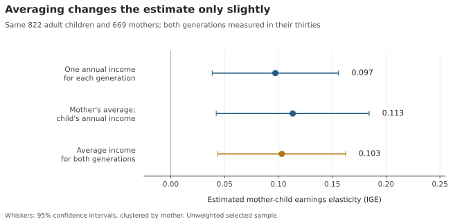
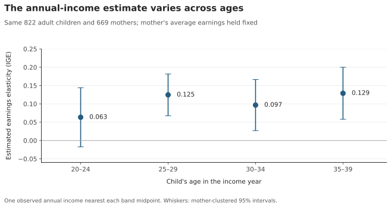

Does averaging earnings across years change the measured link between mothers and their adult children? I matched 822 children to 669 mothers in the NLSY79 and Child/Young Adult surveys. The estimated elasticity was 0.097 using annual records and 0.103 using averages.

An intergenerational elasticity measures a percentage association. The averaged estimate associates 10% higher maternal earnings with roughly 1.0% higher adult-child earnings, after common adjustments. It does not measure a causal parental effect.

## Build one row per child

The [companion notebook](https://github.com/Devinshen123/devinshen123-website/tree/main/blog/posts/post6/code/tutorial.ipynb) loads the extracts into SQLite tables `mothers`, `children`, and `source_income`. Python cleans missing codes and assigns the income reference year. SQL converts earnings to 2020 dollars and creates `stage_income`.

`SELECT` chooses fields. `GROUP BY` combines records for each person and age window. `AVG` averages earnings; `COUNT` checks the number of distinct observed years:

```sql
SELECT generation, person_id, stage,
       AVG(real_income) AS mean_income,
       COUNT(DISTINCT income_year) AS observed_years
FROM stage_income
GROUP BY generation, person_id, stage;
```

These summaries become `stage_averages`. `JOIN` connects each child to adult earnings through their own ID and maternal earnings through their mother ID:

```sql
SELECT c.child_id, c.mother_id,
       m.mean_income AS mother_mean, a.mean_income AS adult_mean
FROM children AS c
JOIN stage_averages AS m
  ON m.person_id = c.mother_id AND m.stage = 'mother30s'
JOIN stage_averages AS a
  ON a.person_id = c.child_id AND a.stage = 'child30s';
```

Aggregating before joining prevents survey years from multiplying matches. The full SQL applies sample rules and creates `matched`, one row per child. Siblings can share a mother.

## Compare annual records with averages

I average real earnings at ages 30–39 before taking logarithms, requiring at least three observed years for mothers and two for children. Years need not be consecutive. Genuine zeros stay in averages; missing answers do not become zeros. Logarithms require positive measures.

With pandas, NumPy and statsmodels imported, Python reads the SQL result and estimates the averaged specification:

```python
sample = pd.read_sql_query("SELECT * FROM matched", connection)
x = pd.DataFrame({
    "log_mother": np.log(sample.mother_mean),
    "mother_age": sample.mother_mean_age - 35,
    "child_age": sample.adult_mean_age - 35,
    "female": (sample.child_sex == 2).astype(int),
    "birth_year": sample.child_birth_year - 1978,
})
fit = sm.OLS(np.log(sample.adult_mean), sm.add_constant(x)).fit(
    cov_type="cluster", cov_kwds={"groups": sample.mother_id},
    use_t=True)
```

The `log_mother` coefficient is the elasticity. All specifications keep the same children and adjustment variables, including both generations' thirties-window mean ages. Intervals cluster by mother to account for siblings.

{fig-alt="Three elasticities compare annual records, averaged maternal earnings with annual child earnings, and averages in both generations."}

Averaging mothers' earnings alone gives 0.113; averaging both gives 0.103. The paired confidence interval for the change includes zero; this sample does not clearly establish a change in the elasticity. A bonus, job loss or time out of work can dominate one annual reading. Averaging reduces the influence of those temporary changes without guaranteeing a higher estimate.

## Check the child's age

For an exploratory age check, I fix maternal average earnings and show every five-year band from 20–24 through 35–39. Each child contributes the annual record nearest each band's midpoint, selected before checking positivity. Both figures use the same children.

{fig-alt="Elasticities for child income measured at ages 20 to 24, 25 to 29, 30 to 34, and 35 to 39."}

The estimates are 0.063, 0.125, 0.097, 0.129, in age order. The paired oldest-minus-youngest confidence interval includes zero, so the apparent age difference is uncertain. [Haider and Solon](https://public.websites.umich.edu/~gsolon/workingpapers/haider.pdf) explain that people with higher lifetime earnings can have faster earnings growth. An early reading can compress the eventual earnings gap. Our uncertain age profile cannot establish that mechanism or reveal the true lifetime elasticity.

The sample requires positive selected annual earnings in every displayed band and enough repeated observations. These selected, unweighted comparisons are not national mobility estimates. Earnings include wages, salaries and military pay, excluding business income. Age and calendar periods also change together. Before interpreting an elasticity, check which people and income years enter it.

## Data and replication

[Full code and README](https://github.com/Devinshen123/devinshen123-website/tree/main/blog/posts/post6) document exclusions, top-coding and the larger-sample sensitivity check. Sources: [official NLS downloads](https://www.nlsinfo.org/content/access-data-investigator/accessing-data-cohorts), [mother–child linkage](https://www.nlsinfo.org/content/cohorts/nlsy79-children/using-and-understanding-the-data/linking-children-young-adults-and), [income definitions](https://nlsinfo.org/content/cohorts/nlsy79-children/topical-guide/income/introduction), and the Minneapolis Fed's [annual CPI-U table](https://www.minneapolisfed.org/about-us/monetary-policy/inflation-calculator/consumer-price-index-1913-).
