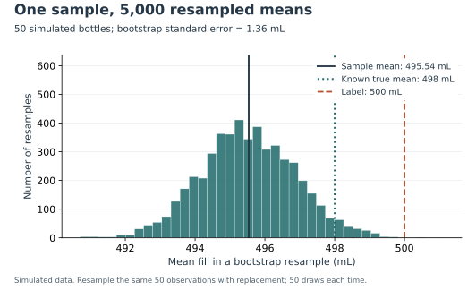
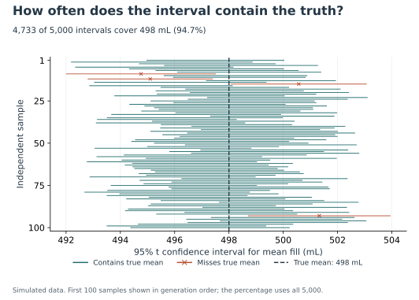
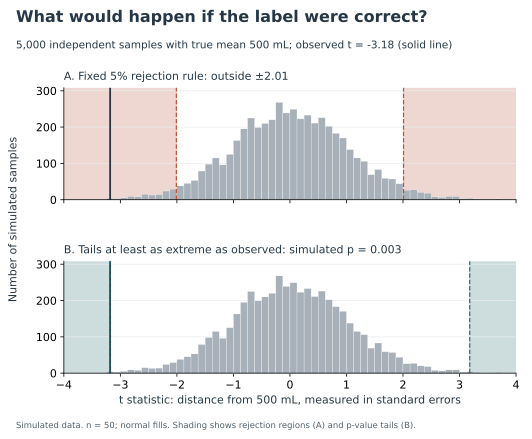

A 500 mL label gives us a number to check. Suppose individual bottles vary, and inspecting every bottle is expensive. **What can a random sample of 50 bottles tell us about whether the average fill really equals 500 mL?**

The question concerns the average across a stable production process. It does not ask whether every bottle contains 500 mL, or how many bottles fall below it. Those would require different calculations.

I explored this with a simulated bottling line: independent, normally distributed fills with a true mean of 498 mL and a standard deviation of 10 mL. These are teaching assumptions, not measurements of a real product. Knowing the true mean lets us check whether our statistical methods work. An inspector examining real bottles would not know that number.

The first sample averaged 495.54 mL. That is below the label, but a sample average can differ from the population average by chance. I used three experiments to examine what the difference means.

## How much could a sample average move?

{#fig-bootstrap fig-alt="Histogram of 5,000 bootstrap sample means, centered near 495.54 mL; the true mean is 498 mL and the label is 500 mL."}

For the bootstrap, I repeatedly drew 50 observations from the original sample, with replacement. A bottle's measurement could appear several times or not at all. After each draw, I calculated another average. This follows [SciPy's description of bootstrap resampling](https://docs.scipy.org/doc/scipy/reference/generated/scipy.stats.bootstrap.html).

@fig-bootstrap shows the resulting 5,000 averages. They cluster around the sample average, with a standard deviation of 1.36 mL. This is the bootstrap estimate of the average's standard error: uncertainty about an average, rather than the variation between individual bottles.

Resampling cannot reveal the true mean automatically. Here the histogram is centered below the known 498 mL because the original sample happened to underestimate it.

## What does 95% confidence look like in practice?

{#fig-coverage fig-alt="One hundred horizontal confidence intervals with a vertical line at the known true mean of 498 mL. Intervals missing that line have cross markers. Across all 5,000 trials, 94.66 percent cover the true mean."}

Next, I generated 5,000 fresh samples from the 498 mL population. For each, I constructed a two-sided Student's t interval with 49 degrees of freedom: the sample average plus or minus about 2.01 estimated standard errors. These are t intervals; the bootstrap histogram above is a separate experiment.

Of the intervals, 4,733 contained 498 mL: 94.66%. @fig-coverage displays the first 100 in generation order. Most cross the true-mean line; a few miss it. The overall rate need not equal exactly 95% in a finite simulation.

As [NIST explains](https://www.itl.nist.gov/div898/handbook/eda/section3/eda352.htm), confidence describes the procedure's long-run coverage. It is not a statement that 95% of bottles are adequately filled. For our original sample, the same procedure gives an interval from 492.72 to 498.36 mL.

The known 498 mL lies inside it, whereas 500 mL does not. This distinction becomes useful when we ask whether the sample is consistent with the label.

## Would this result be unusual if the label were correct?

{#fig-null fig-alt="Two histograms of 5,000 t statistics generated under a 500 mL mean. The upper panel shades the fixed two-sided 5 percent rejection regions beyond plus or minus 2.01; the lower panel shades values at least as extreme as the observed t of -3.18."}

The last experiment assumes the true mean really is 500 mL. From 5,000 new samples, I calculated [t statistics](https://docs.scipy.org/doc/scipy/reference/generated/scipy.stats.ttest_1samp.html), which measure the distance between a sample average and 500 mL in estimated standard errors.

In @fig-null, the upper panel shows the pre-set 5% rejection rule: reject equality when the statistic falls beyond approximately 2.01 in either direction. Our sample's statistic is -3.18, inside the left rejection region.

The lower panel answers the p-value question. Under that 500 mL model, how often would a statistic be at least as far from zero as ours, in either direction? There were 15 such simulations. With a one-count correction, the estimated p-value is 0.0032, comfortably below 0.05. This is evidence against the 500 mL mean under the model, not the probability that the label is correct.

The simulation's Monte Carlo standard error is about 0.0008. Extra repetitions would stabilize the p-value estimate; they would not add information to the original bottle sample.

This sample detects a shortfall, but its estimated size is noisy: the sample average is below even the known 498 mL. The interval communicates that uncertainty. Applying these methods to a real production line would require checking independence and process stability; repeated bottles from one batch could tell us less than this simulation assumes.

Data: entirely simulated. [Replication and assumptions](README.md) · [Saved calculations](results/summary.json) · [Runnable notebook](code/analysis.ipynb).
