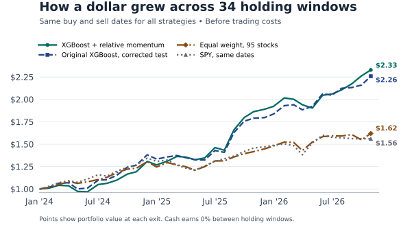

A stock gained 5% last month. Is that a promising sign if the S&P 500 gained 8%? A model that looks at the stock's return alone sees a winner. A model that compares it with the market sees a laggard. I wanted to know whether giving our class's stock model that comparison would help it choose its next ten stocks.

## What happened in class?

In the [class stock game](https://canvas.upenn.edu/courses/1942733/discussion_topics/11420590), the results sheet pairs a portfolio chosen by intuition with one chosen using indicators. The indicator portfolio finished ahead in 30 of 45 pairs. The average gap in final value was about $1,909. Those are the results of the game; the spreadsheet contains final balances, so it cannot tell us how accurately a model forecast individual returns.

The [instructor's model](https://canvas.upenn.edu/courses/1942733/files?search_term=stock&preview=166069948) used XGBoost, which builds a series of small decision trees to reduce earlier prediction errors. It used past prices, recent trends, and volatility to forecast the return from the next trading day's close to the close twenty trading days after the prediction. It then ranked stocks by those forecasts. Unexpected earnings or market news can swamp patterns learned from prices. [Gu, Kelly, and Xiu](https://doi.org/10.1093/rfs/hhaa009) find that recent price trends can be informative, while noting how small the predictable signal is relative to the noise.

## Does the extra signal improve forecasts?

I used daily [Yahoo Finance prices](https://business-science.github.io/tidyquant/reference/tq_get.html) for the original list of 95 stocks and SPY, an ETF that tracks the S&P 500. The new input subtracts SPY's return from the stock's return over 21 trading days ending the day before the forecast. Both versions use the instructor's model settings. I held out 2024 onward for testing and dropped 1,900 training rows whose return calculations reached into 2024. Otherwise the model would have learned from prices that were supposed to be held out.

::: {#tbl-forecasts}

| Forecast | RMSE | MAE |
|:--|--:|--:|
| Training-period average | 8.88 | 6.42 |
| Original XGBoost | 9.40 | 6.85 |
| XGBoost with relative momentum | 9.38 | 6.83 |

Forecast errors in percentage points, on the same 66,215 stock-date observations. Lower is better.

:::

The extra input lowered the root mean squared error, which gives larger misses more weight, by about 0.02 percentage points. The mean absolute error moved by about the same amount. Both models lost to the plain training-period average, a forecast of 1.34% for every stock. If I needed a number for a typical stock in this sample, the simple average would have been the better starting point.

## What happened to a dollar?

For each of 34 months, I ranked stocks using the first trading day's forecasts and bought from the top ten at the next close. Positive forecasts determined the weights, which I normalized to sum to 100%. The equal-weight portfolio held all 95 stocks. It and SPY entered and exited on exactly the same dates as the model portfolios. All four sat in cash between windows. The comparison ends on October 29, 2026, the last monthly exit observable with prices through November 9.

{#fig-wealth fig-alt="Four lines start at one dollar in January 2024. By October 2026 the relative-momentum model ends at $2.33, the original model at $2.26, the equal-weight portfolio at $1.62, and SPY at $1.56."}

@fig-wealth shows the relative-momentum portfolio gained **132.8%**, compared with **125.8%** for the original model, **61.9%** for equal weighting, and **56.0%** for SPY. The new model beat the original in 18 of 34 windows. Forecast errors give every stock and date a vote; the portfolio depends on a handful of stocks on one date each month. A small change near the top of the rankings can matter to one measure without doing much for the other.

Prices and trading volumes can be rescaled after events such as stock splits. I also ran both models without those levels. The relative-momentum portfolio still finished ahead of the original, and both models still forecast less accurately than the historical average.

The extra signal helped the portfolio in this sample and barely changed the accuracy of individual forecasts. The test uses a fixed list of large stocks, covers fewer than three years, and excludes trading costs. I would want to see the same result on an earlier period and a stock list known at the time before treating the gain as evidence of a repeatable edge.

[Replication notes](README.md) · [Code on GitHub](https://github.com/Devinshen123/devinshen123-website/tree/main/blog/posts/post9) · [Forecast results](results/comparison/prediction_metrics.csv) · [Portfolio results](results/comparison/portfolio_metrics.csv) · [Returns by holding period](results/comparison/portfolio_periods.csv)
